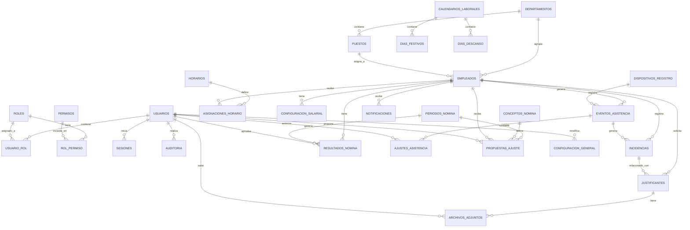

# DIAGRAMA ENTIDAD-RELACIÓN - Hamelín RH

**Producto:** Hamelín RH  
**Cliente:** Cool Circle  
**Versión:** 1.0  
**Estado:** Representa el modelo implementado en `server/app/models` y las migraciones de Alembic.

---

## 1. Diagrama ER (Mermaid)

---

## 2. Descripción de entidades principales

| Entidad | Descripción | Clave primaria |
|---|---|---|
| usuarios | Usuarios del sistema (clientes de escritorio) | id (UUID) |
| roles | Roles del sistema (RBAC) | id (UUID) |
| permisos | Permisos granulares por módulo y operación | id (UUID) |
| usuario_rol | Relación muchos a muchos usuario-rol | (usuario_id, rol_id) |
| rol_permiso | Relación muchos a muchos rol-permiso | (rol_id, permiso_id) |
| sesiones | Sesiones activas y revocadas (JWT) | id (UUID) |
| auditoría | Registro inalterable de operaciones sensibles | id (UUID) |
| departamentos | Catálogo de departamentos de la empresa | id (UUID) |
| puestos | Puestos laborales dentro de un departamento | id (UUID) |
| horarios | Horarios de entrada/salida y tolerancia | id (UUID) |
| asignaciones_horario | Historial de asignación de horario a empleado con vigencia | id (UUID) |
| calendarios_laborales | Calendarios de trabajo | id (UUID) |
| dias_festivos | Días festivos por calendario | id (UUID) |
| dias_descanso | Días de descanso por semana | id (UUID) |
| configuracion_general | Clave-valor de configuración del sistema | clave |
| empleados | Empleados de Cool Circle | id (UUID) |
| configuracion_salarial | Historial de sueldo base y periodicidad con vigencia | id (UUID) |
| dispositivos_registro | Dispositivos de registro de asistencia | id (UUID) |
| eventos_asistencia | Eventos de entrada/salida/otro | id (UUID) |
| ajustes_asistencia | Correcciones auditables de eventos | id (UUID) |
| incidencias | Retardos, faltas, salidas incompletas, etc. | id (UUID) |
| justificantes | Justificaciones médicas, legales, tránsito, otras | id (UUID) |
| archivos_adjuntos | Documentos adjuntos protegidos a justificantes | id (UUID) |
| notificaciones | Notificaciones internas a RRHH | id (UUID) |
| periodos_nomina | Periodos de nómina (quincenales, etc.) | id (UUID) |
| conceptos_nomina | Conceptos permitidos de prenómina | id (UUID) |
| propuestas_ajuste | Propuestas de ajuste económico por empleado y periodo | id (UUID) |
| resultados_nomina | Vista previa de prenómina por empleado y periodo | id (UUID) |

---

## 3. Reglas de integridad implementadas

- `empleados.numero_empleado` único.
- `usuarios.username` y `usuarios.email` únicos.
- `dispositivos_registro.identificador_externo` único cuando se provee.
- `horarios.codigo` único.
- `periodos_nomina.fecha_inicio` y `fecha_fin` no se solapan (validación en servicio).
- Eliminación lógica: `empleados.eliminado_en`, `departamentos.activo`, `puestos.activo`, `horarios.activo`.
- `auditoria` no tiene restricciones de borrado; es de solo lectura para usuarios ordinarios.
- Consultas parametrizadas mediante SQLAlchemy ORM (protección contra inyección SQL).

---

## 4. Notas de implementación

- Todas las tablas incluyen `fecha_creación` y, cuando aplica, `fecha_modificación`.
- Las claves foráneas usan `ON DELETE` adecuado (RESTRICT para entidades maestras, SET NULL o CASCADE documentado por caso).
- Los datos biométricos no se almacenan en la base de datos central por defecto (ver `docs/SEGURIDAD_Y_PRIVACIDAD.md`).
- Las contraseñas se almacenan únicamente como hash Argon2id en `usuarios.password_hash`.