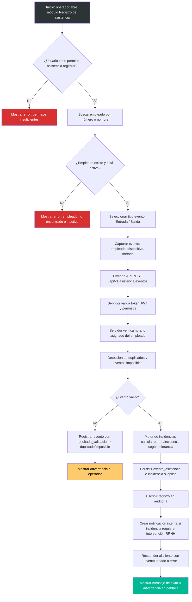
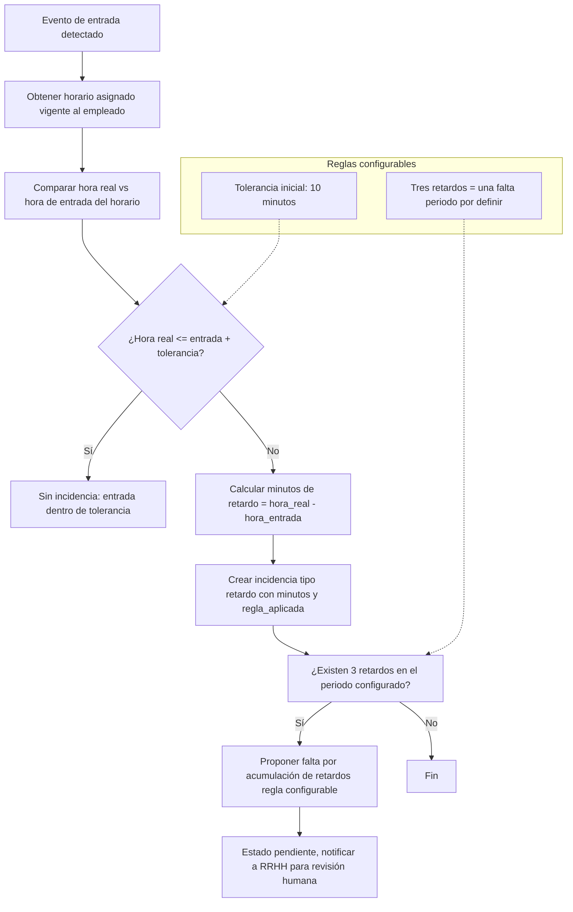
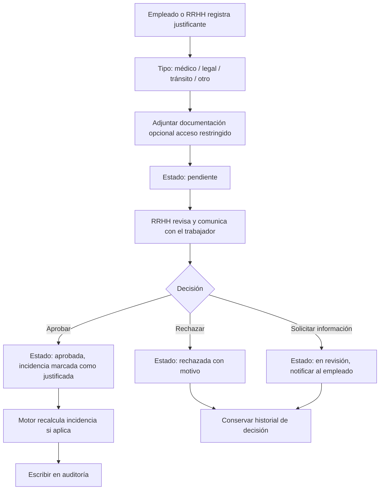
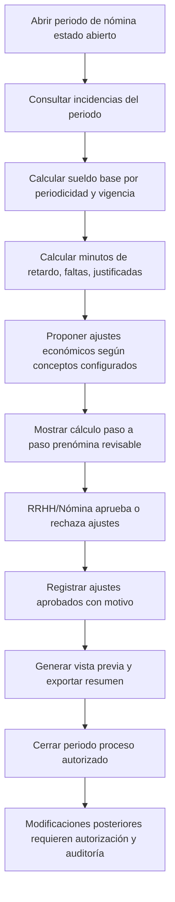

# DIAGRAMA DE FLUJO DE ASISTENCIA - Hamelín RH

**Producto:** Hamelín RH  
**Cliente:** Cool Circle  
**Versión:** 1.0  
**Estado:** Representa el flujo implementado en los módulos de registro de asistencia y motor de incidencias.

---

## 1. Flujo de registro de entrada/salida (Mermaid)

---

## 2. Flujo de cálculo de incidencia (motor de reglas)

---

## 3. Flujo de justificación de incidencia

---

## 4. Flujos de prenómina

---

## 5. Reglas de negocio clave del flujo

1. **Tolerancia:** 10 minutos iniciales. Se documenta si el minuto límite está dentro o fuera de la tolerancia (valor provisional: minuto 11 está fuera).
2. **Tres retardos = una falta:** regla configurable, periodo por definir (valor demo: quincena).
3. **No descuento automático:** ninguna falta o retardo se convierte en descuento salarial sin revisión humana y autorización.
4. **Justificantes:** aprobados solo por usuarios autorizados; protegen datos sensibles (no mostrar diagnósticos médicos a quien solo consulta estado).
5. **Historial inalterable:** los eventos de asistencia no se borran silenciosamente; las correcciones generan ajustes con valor anterior, valor corregido, motivo, fecha y responsable.
6. **Detección de anomalías:** duplicados, eventos imposibles y entradas sin salida asociada se detectan y marcan.

---